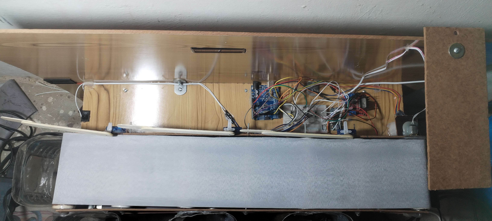

# Smart Bin — AI-Based Waste Segregation System

A conveyor-based waste-sorting prototype that photographs each item, classifies it
with a YOLOv8 classification model, and routes it into the correct bin with servo
actuators. Built as a BS Artificial Intelligence final-year project at the Islamia
University of Bahawalpur (2022–2026), self-funded from pocket money.

**Authors:** Muhammad Ahsan Shah (Information Technology University, Lahore),
Afifa (Government College Women University, Bahawalpur), Tayyaba Noor
(Namal University, Mianwali)

**Paper:** `paper/smart-bin-ieee-conference-paper.docx` — submitted to ICECT 2027
(5th International Conference on Engineering and Computing Technologies, NUML
Islamabad, 18–19 March 2027).

## Results (verified)

| Metric | Value |
|---|---|
| Classifier test top-1 accuracy (1,032 images) | **95.06%** |
| Classifier validation top-1 accuracy | 95.91% |
| Physical sorting accuracy (40 items on the conveyor) | **85.0% (34/40)** |
| Model | YOLOv8n-cls, 30 epochs, 224×224, Tesla T4 (~23 min) |
| Inference latency (T4, model only) | mean 14 ms, p95 31 ms |

The 6 physical-sorting errors were traced to poorly resolved ESP32-CAM captures
causing misclassification — not to servo/mechanical failures. Classifier accuracy
and physical sorting accuracy are different measurements and are never averaged.

Per-class test results (precision / recall / F1): Paper .965 / .993 / .979,
Plastic .937 / .885 / .910 (weakest — 34 plastic↔Others confusions),
Food .982 / .991 / .986, Others .924 / .937 / .930. See `results/` for the
confusion matrix, per-class chart, threshold sweep and training curves.



## How it works

```
Waste on conveyor → HC-SR04 ultrasonic sensor (<20 cm)
  → Arduino sends "D" → ESP32-CAM captures a frame (HTTP /capture)
  → Desktop app (Python + Ultralytics YOLO + OpenCV + Tkinter)
     classifies into Plastic / Paper / Food / Others
  → single-char command (P / A / F / O) over serial @ 9600 baud
  → Arduino drives the conveyor + one of 3 SG90 servos
  → item lands in its bin; confidence < 60% → Others (fail-safe)
```

## Hardware

- Arduino Uno + L298N motor driver + 12 V DC gear motor (conveyor)
- ESP32-CAM (AI-Thinker, OV2640) — captures only; YOLO runs on the PC
- HC-SR04 ultrasonic sensor, 3× SG90 servos, 16×2 I2C LCD

## Repository layout

```
arduino/        Arduino Uno firmware (sensor, conveyor, servos)
esp32/          ESP32-CAM firmware (capture server)
desktop-app/    Python classifier + Tkinter GUI (smart_bin_yolov8l_v4.py)
training/       Retraining notebook (Colab) + provenance-audit notebook
dataset/        Dataset notes: RealWaste remap, counts, licence
results/        Confusion matrix, per-class metrics, threshold sweep, curves
figures/        Prototype photo, GUI screenshot
paper/          IEEE conference paper (ICECT 2027 submission version, 6 pp.)
```

## Setup

1. Flash `esp32/ESP32Code.ino` to the ESP32-CAM and `arduino/ArduinoCode.ino`
   to the Arduino Uno. **Replace `<YOUR_WIFI_SSID>` / `<YOUR_WIFI_PASSWORD>`
   in the ESP32 code and the camera IP in `desktop-app/smart_bin_yolov8l_v4.py`
   with your own values** — no credentials are stored in this repo.
2. Install dependencies: `pip install ultralytics opencv-python pyserial`
   (plus `tkinter`, usually bundled with Python).
3. Place a trained `best.pt` next to the desktop app and run
   `python desktop-app/smart_bin_yolov8l_v4.py`.

> Which ESP32 sketch is final (`ESP32Code.ino` vs `esp32/sketch_dec25b.ino`,
> an older/alternate version) is not yet confirmed — `ESP32Code.ino` is the
> presumed final one.

## Dataset

The classifier was trained on a 4-class remap of **RealWaste** (Single, Iranmanesh
& Raad, *Information* 2023, 14(12), 633, DOI: 10.3390/info14120633), plus local
phone photos. Our prepared 4-class copy (`realwaste1.zip`, 6,851 images, ~487 MB):

https://drive.google.com/file/d/195VK0WUYTPdnCXFdH0YHNOoF44A8O8f1/view?usp=sharing

See `dataset/README.md` for the remap, counts and licence (CC BY-NC-SA 4.0).
The dataset images themselves are **not** in this repo — download RealWaste from
[Kaggle](https://www.kaggle.com/datasets/joebeachcapital/realwaste) or our
prepared copy from the Drive link above.

## Licence

Code in this repo is released under the MIT Licence (see `LICENSE`). The
RealWaste dataset remains under its own CC BY-NC-SA 4.0 licence — if you use
the dataset, cite Single et al. (2023) and respect the non-commercial,
share-alike terms.
